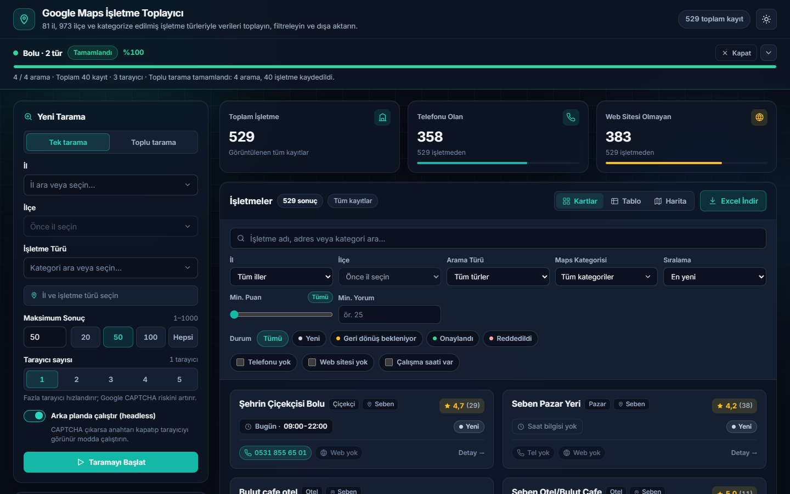
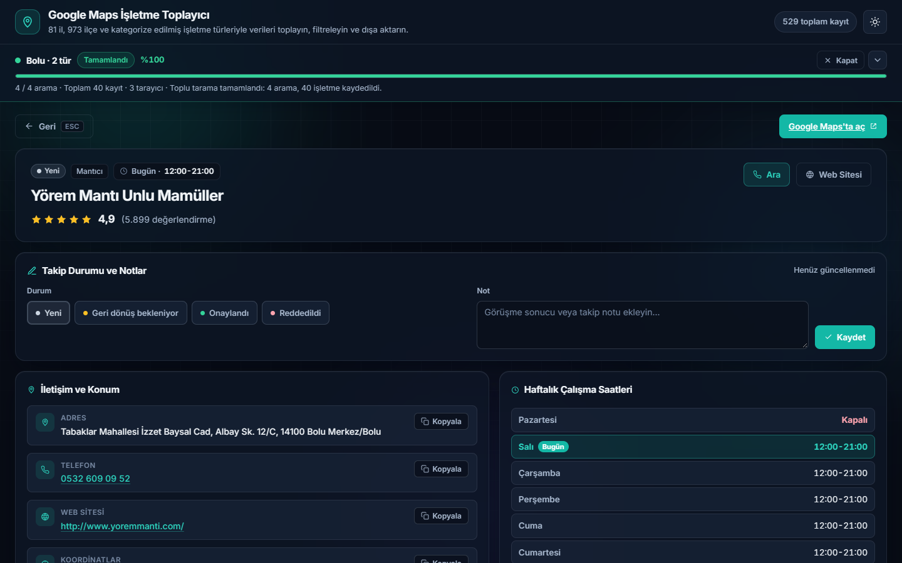

# maps-isletmeler

Google Maps'te seçilen bölge ve işletme türüne göre işletme bilgilerini toplayan, SQLite'a kaydeden ve Excel'e aktaran yerel web uygulaması.

Türkiye'nin 81 il / 973 ilçesi ve 63 işletme türü listeden seçilir; tek arama ya da çok ilçe × çok tür toplu tarama yapılır.





## Özellikler

- **Toplanan alanlar:** ad, kategori, adres, koordinat, telefon, web sitesi, puan, yorum sayısı, haftalık çalışma saatleri, Maps bağlantısı / `place_id`
- **Tek ve toplu tarama:** il + ilçe(ler) + tür(ler) seçimi; "Hepsi" seçeneğiyle listenin sonuna kadar tarama
- **Paralel tarayıcı:** 1–5 tarayıcı (panelden seçilir); detay sayfaları tarayıcılara bölünür
- **Canlı ilerleme çubuğu:** duraklat / devam et / iptal et; CAPTCHA görülünce tarama otomatik durur
- **Liste görünümleri:** kart, tablo ve harita (Leaflet + kümeleme); sayfa başına 12 kayıt
- **Filtreler:** il, ilçe, tür, Maps kategorisi, minimum puan / yorum, telefonu yok, web sitesi yok, çalışma saati var, takip durumu
- **Detay sayfası:** 7 günlük çalışma saatleri, konum haritası, kopyalanabilir iletişim bilgileri
- **Takip durumu:** Yeni / Geri dönüş bekleniyor / Onaylandı / Reddedildi + not alanı (yeniden taramada korunur)
- **Excel dışa aktarım:** tüm kayıtlar ya da yalnızca filtrelenmiş olanlar (`.xlsx`)
- Koyu / açık tema, mobil uyumlu arayüz

## Gereksinimler

- Python 3.13
- Microsoft Edge (varsayılan tarayıcı). Playwright'ın kendi Chromium'u Maps'te "sınırlı görünüm" aldığı için (yorum sayısı ve haftalık saatler gelmez) sistemde kurulu Edge kullanılır.

## Kurulum

```bash
git clone https://github.com/SametDrs/maps-isletmeler.git
cd maps-isletmeler
python -m venv .venv
# Windows
.venv\Scripts\activate
# macOS / Linux
source .venv/bin/activate
pip install -r requirements.txt
```

Edge kurulu değilse ya da Chrome kullanmak istersen ortam değişkeniyle kanalı değiştir:

```bash
# Chrome
set MAPS_BROWSER_CHANNEL=chrome        # Windows (cmd)
export MAPS_BROWSER_CHANNEL=chrome     # macOS / Linux
# Playwright'ın kendi Chromium'u (sınırlı veri)
playwright install chromium
set MAPS_BROWSER_CHANNEL=
```

## Çalıştırma

```bash
uvicorn app.main:app --port 8765
```

Tarayıcıda `http://127.0.0.1:8765` adresini aç.

1. Sol panelden **Tek tarama** ya da **Toplu tarama** seç.
2. İl, ilçe(ler) ve işletme türü(ler)ini seç; maksimum sonuç ve tarayıcı sayısını ayarla.
3. Taramayı başlat. İlerleme üstteki çubukta görünür; sonuçlar listeye canlı düşer.
4. Filtrele, detay sayfasından takip durumunu işaretle, **Excel İndir** ile dışa aktar.

CAPTCHA çıkarsa "Arka planda çalıştır (headless)" seçeneğini kapatıp görünür modda tekrar dene; daha az tarayıcı kullan.

## API

| Yöntem | Yol | Açıklama |
|---|---|---|
| `POST` | `/api/jobs` | Tek tarama: `{region, category, max_results (null = hepsi), headless, workers}` |
| `GET` | `/api/jobs/{id}` | Tarama durumu |
| `POST` | `/api/jobs/{id}/cancel` | Taramayı iptal et |
| `POST` | `/api/batches` | Toplu tarama: `{items: [{region, category}], max_results, headless, workers, label}` |
| `GET` | `/api/batches/{id}` | Toplu tarama durumu |
| `POST` | `/api/batches/{id}/pause` · `/resume` · `/cancel` | Duraklat / devam et / iptal et |
| `GET` | `/api/active` | Çalışan tarama ya da toplu tarama |
| `GET` | `/api/businesses` | Kayıtlar (`region`, `category` filtreleri) |
| `PATCH` | `/api/businesses/{place_id}/status` | Takip durumu: `{durum, not}` |
| `DELETE` | `/api/businesses` | Tüm kayıtları sil |
| `GET` | `/api/searches` | Önceki taramalar |
| `GET` / `POST` | `/api/export.xlsx` | Excel; `POST` ile `{ids}` filtreli dışa aktarım |

## Proje yapısı

```
app/
  scraper.py   Playwright ile Maps arama, kaydırma, detay çekme (DOM seçicileri dosya başında)
  db.py        SQLite şeması, kayıt ve tekilleştirme (place_id / Maps URL)
  export.py    SQLite -> .xlsx
  main.py      FastAPI: tarama işleri, toplu tarama, kayıtlar, Excel
  static/      Arayüz (HTML/CSS/JS, build adımı yok) + il/ilçe ve tür listeleri
data/          SQLite veritabanı (git dışı)
exports/       Üretilen Excel dosyaları (git dışı)
```

## Sorumluluk reddi

Bu proje eğitim ve kişisel kullanım amaçlıdır. Google Maps'in otomatik araçlarla taranması [Google Hizmet Şartları](https://policies.google.com/terms)'na aykırı olabilir; IP kısıtlaması ve CAPTCHA ile sonuçlanabilir. Toplanan verilerin kullanımı (ör. KVKK / GDPR, ticari ileti mevzuatı) kullanıcının sorumluluğundadır. Google DOM yapısını değiştirdiğinde seçicilerin `app/scraper.py` başında güncellenmesi gerekir.

## Lisans

[MIT](LICENSE)
